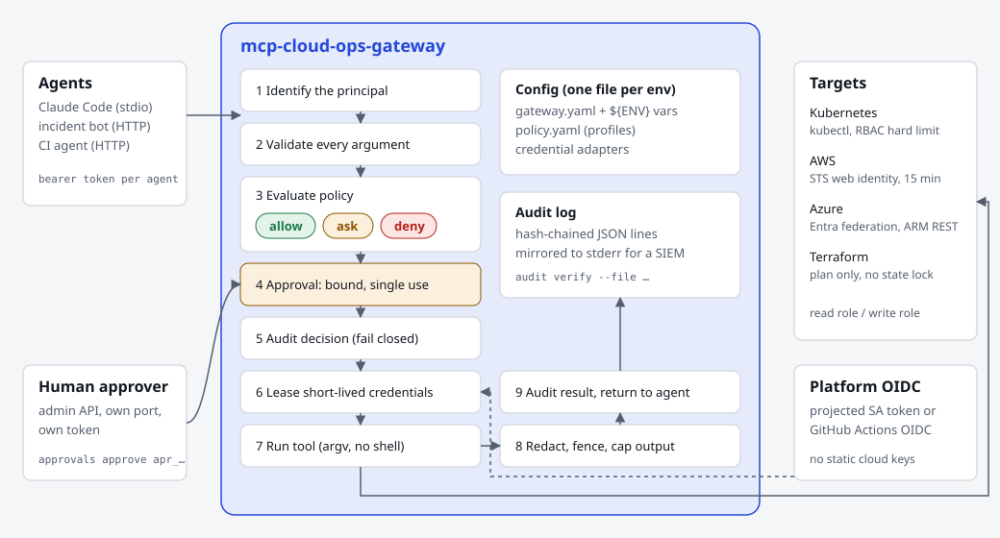

# mcp-cloud-ops-gateway

A governed [Model Context Protocol](https://modelcontextprotocol.io) server that lets AI agents run cloud and Kubernetes operations without handing them the keys.

Agents get tools such as `k8s_get`, `k8s_scale`, `terraform_plan`, `aws_cloudwatch_alarms` and `azure_resource_list`. Every call passes through one pipeline: identify the caller, validate every argument, check the policy (allow, ask or deny), get a human approval when the policy says ask, write a tamper-evident audit record, lease short-lived credentials, run the tool, then redact secrets and fence the output as untrusted data.



## Why it exists

Giving an agent `kubectl` or a cloud CLI with a long-lived key is the fastest way to get an incident. The usual fixes (a read-only key, a prompt that says "be careful") are either too weak or too blunt. This gateway sits between the agent and the platform and makes the rules explicit, testable and auditable:

- **Least privilege per agent.** Each agent has its own token and policy profile. A triage bot reads; an on-call agent can scale with a human in the loop; nobody deletes pods in production.
- **Humans approve changes, out of band.** Approvals go through a separate admin API that agents cannot reach. An approval is bound to the exact call (a digest of principal, tool and arguments), single use and short-lived.
- **No static cloud keys.** The gateway exchanges its platform OIDC token (a Kubernetes projected token or the GitHub Actions token) for credentials that last minutes: AWS STS web identity or Entra ID workload identity federation. Read tools and mutating tools use different roles.
- **Evidence by default.** Every decision and result lands in a hash-chained JSON log. `audit verify` detects an edited, deleted or reordered line.
- **Prompt-injection defences in depth.** Tool output is redacted, fenced and scanned for instruction-like text; the real defence is that output cannot change policy and every change needs a human.

## Status

Version 0.1, first public cut. What is verified and what is not is in [docs/EVIDENCE.md](docs/EVIDENCE.md). In short: unit and integration tests (11 packages, race detector on), plus an end-to-end run of the real binary over stdio against a real Kubernetes API server (kwok). AWS and Azure are verified against mock token and API endpoints only; no live cloud account was used.

## Quick start (local, 5 minutes)

Needs Go 1.25+ and `kubectl` pointing at a test cluster (kind, kwok, minikube). PowerShell shown; the commands are the same in bash.

```powershell
git clone https://github.com/kaushik-sai/mcp-cloud-ops-gateway
cd mcp-cloud-ops-gateway
go build -o bin/mcp-cloud-ops-gateway ./cmd/mcp-cloud-ops-gateway

# Check the example config and policy, and see what each principal may do.
./bin/mcp-cloud-ops-gateway validate --config examples/gateway.yaml
```

Edit `examples/gateway.yaml` so `credentials.local-cluster.context` names your cluster context, then register the gateway with Claude Code:

```powershell
claude mcp add cloud-ops -- "$PWD/bin/mcp-cloud-ops-gateway" serve --config "$PWD/examples/gateway.yaml" --stdio
```

Ask Claude "what may you do on the cluster?" (it calls `gateway_policy`), then "scale deployment api in namespace demo to 3". The gateway answers with an approval ID. Approve it from another terminal:

```powershell
$env:MCPGW_ADMIN_TOKEN = 'approver-example-token-change-me-00000000000000000000'   # example only
./bin/mcp-cloud-ops-gateway approvals list
./bin/mcp-cloud-ops-gateway approvals approve apr_xxxxxxxxxxxxxxxx --note "load test"
```

Claude repeats the call with the approval ID and the scale runs. Then check the evidence:

```powershell
./bin/mcp-cloud-ops-gateway audit verify --file examples/audit.jsonl
```

Replace the example tokens before using this anywhere real: `openssl rand -hex 32 | ./bin/mcp-cloud-ops-gateway hash-token`.

## Tools

| Tool | Group | Kind | What it does |
|---|---|---|---|
| `gateway_policy` | built-in | read | Who am I, and the effect of every tool for me |
| `k8s_get` | kubernetes | read | Get or list objects in one namespace (allowlisted kinds; never Secrets) |
| `k8s_logs` | kubernetes | read | Tail a pod's logs (capped lines) |
| `k8s_scale` | kubernetes | mutating | Set a deployment's replicas (0 to 50), server-side dry run supported |
| `k8s_rollout_restart` | kubernetes | mutating | Rolling restart of a deployment, dry run supported |
| `k8s_delete_pod` | kubernetes | destructive | Delete one pod |
| `aws_ec2_describe_instances` | aws | read | Describe instances in a region |
| `aws_cloudwatch_alarms` | aws | read | Alarms by state |
| `aws_ec2_reboot_instance` | aws | mutating | Reboot one instance, EC2 dry run supported |
| `azure_resource_list` | azure | read | Resources in a resource group (ARM REST) |
| `azure_vm_restart` | azure | mutating | Restart one VM |
| `terraform_plan` | terraform | read | `terraform plan` in an operator-named workspace, no state lock |

A group's tools are served only when the config has that group, so a Kubernetes-only deployment exposes no cloud tools. Agents name targets by alias (a Terraform workspace name, an Azure subscription alias), never by path or ID.

## Configuration in one place

One YAML file per environment plus one policy file. Values that change between environments come from `${ENV_VAR}` references, so the same file is copied between dev, staging and prod unchanged. Callers are listed by the SHA-256 of their token; the file holds no secrets.

| File | Holds |
|---|---|
| [examples/gateway.yaml](examples/gateway.yaml) | listeners, principals, approvers, credential adapters, enabled groups, limits |
| [examples/policy.yaml](examples/policy.yaml) | profiles of allow / ask / deny rules with argument conditions |
| [deploy/kubernetes/](deploy/kubernetes/) | Kustomize base plus `dev` and `prod` overlays |

Every field is described in [docs/CONFIGURATION.md](docs/CONFIGURATION.md). Adding a cloud, a tool or a credential type is a small, local change: see [docs/EXTENDING.md](docs/EXTENDING.md).

## For other agents and projects

Sibling projects (agentic incident response, SaaS integration hub, model tuning) call this gateway as their only path to infrastructure. The contract (tools, arguments, result shape, approval handshake, auth) is in [docs/INTEGRATION.md](docs/INTEGRATION.md).

## Documentation

| Doc | What it covers |
|---|---|
| [DESIGN.md](DESIGN.md) | Architecture, request pipeline, components, scaling |
| [RUNBOOK.md](RUNBOOK.md) | Deploy, rotate tokens, approve, verify audit, troubleshoot |
| [SECURITY.md](SECURITY.md) | Security model, reporting a vulnerability |
| [docs/THREAT_MODEL.md](docs/THREAT_MODEL.md) | Threats and the control for each |
| [docs/CONFIGURATION.md](docs/CONFIGURATION.md) | Every config and policy field |
| [docs/INTEGRATION.md](docs/INTEGRATION.md) | The interface for agents and sibling projects |
| [docs/EXTENDING.md](docs/EXTENDING.md) | Add a tool, a group or a credential adapter |
| [docs/DECISIONS.md](docs/DECISIONS.md) | Numbered design decisions and why |
| [docs/EVIDENCE.md](docs/EVIDENCE.md) | What was run, with results; what is not verified |

## Development

```powershell
pwsh ./scripts/Invoke-LocalChecks.ps1     # gofmt, vet, golangci-lint, tests (race), govulncheck, actionlint, gitleaks
go test -race ./...
$env:E2E_KUBE_CONTEXT = 'kind-gw'; go test -tags e2e -v ./test/e2e/   # needs a throwaway cluster
```

CI runs the same checks on every PR (`ci.yml`, `security.yml`, `pr-policy.yml`), with actions pinned by SHA and tools checked against their published SHA-256. Governance follows [governed-repo-template](https://github.com/kaushik-sai/governed-repo-template).

## License

See [LICENSE](LICENSE).
